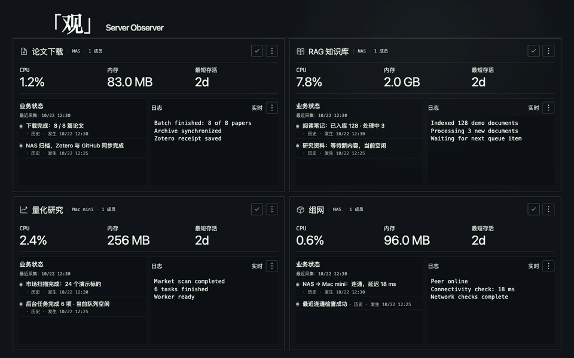
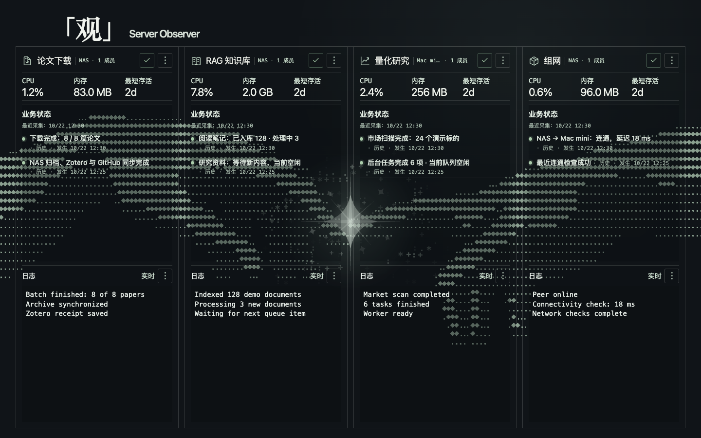
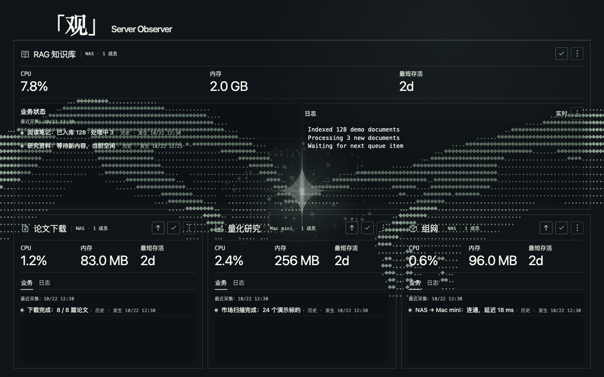

<h1 align="center">View · Server Observer</h1>
<p align="center"><strong>「观」</strong></p>
<p align="center">Bring scattered services into one quiet window.</p>
<p align="center">macOS · Electron · Docker · SSH · ASCII</p>

**English (primary)** | [简体中文](README.zh-CN.md)

---

View is a personal service-monitoring app for macOS. Connect to local Docker or Docker over SSH, and bring container health, natural-language business status, and logs together.

It suits always-on mini servers and anyone who wants a quick look at whether their own services are working.

## Interface preview

These previews use real interface components with offline demo data. They do not show personal service records, addresses, or credentials.

<p align="center"></p>
<p align="center"><sub>Full ASCII background cycle · The GIF is compressed; the app renders the animation continuously on Canvas.</sub></p>

<details>
<summary><strong>Four columns and one large / three small panels</strong></summary>





</details>

## See at a glance, expand when needed

- **Four replaceable slots:** switch between four columns, a 2×2 grid, and one large / three small panels in the system View menu.
- **Services can span containers and devices:** titles identify devices and members, resource metrics stay concise, and details expand on demand.
- **Business status before logs:** wide cards can show both side by side; narrow cards switch between business status and logs so long text is not squeezed into a thin column.
- **Current and historical information stay distinct:** show the latest collection time separately, preserve original event dates, and identify stale results when reads fail.
- **Animated ASCII background:** hands approach, touch, and dissolve, with brightness controls, a static mode, and reduced motion.

Dedicated readers currently cover paper receipts, RAGFlow, Quant PostgreSQL, Tailscale, certificates, and OpenResty, alongside registered HTTP status sources. **Discovering a container does not automatically reveal business progress:** business status needs the service's corresponding data source and read contract.

## Quick start

Requires macOS, Node.js **24.22.0**, and npm **11.6–11.x**. Docker and SSH are needed only when adding the corresponding devices.

```bash
git clone https://github.com/XingjianTian/View.git
cd View
npm ci
npm run dev
```

On first use, register connection information stored outside the repository in **观 → 设置** (View → Settings). Add devices, services, and container members, then select them for the dashboard. Refresh with `⌘R`, open settings with `⌘,`, and switch layouts with `⌘1` / `⌘2` / `⌘3`.

```bash
npm run typecheck
npm test
npm run build
npm run package -- --platform=darwin --arch=arm64
npm run verify:package
```

Packages are written to `out/`. The project does not currently provide signing, notarization, automatic updates, or an installer release workflow.

## Keep configuration local

The default data directory is `~/Library/Application Support/ServiceObservatory`. Real SSH profiles, authentication information, status-source registrations, and device configuration stay on the local machine and are not distributed with the source.

`.env.example` documents the available environment variables. **Ordinary `npm run dev` does not automatically load `.env`.** To use a separate data directory, copy the template and load it explicitly:

```bash
cp .env.example .env
# Set an absolute path, then run:
node --env-file=.env scripts/dev.mjs
```

See [configuration](docs/configuration.md) for connection examples and registration steps. Business sources still need checking against the actual deployment; no presets connect directly to a personal server.

## Before contributing

```bash
brew install gitleaks
npm run hooks:install
npm run privacy:check
```

Local hooks check staged content and commits awaiting push; CI adds type checks, unit tests, and secret scanning. Real `.env` files, private profiles, databases, logs, internal operational records, and backups are excluded by default. Register additional private files in a local `.privacy.local.json` for exact comparison; that file is also excluded from commits. See [privacy checks](docs/privacy.md).

## Current boundaries

View reads and displays information. It does not provide controls to start jobs, renew certificates, reload proxies, or modify production services. Sources may lack history, heartbeats, or failure details; preserve unknown, partially covered, or read-error states rather than equating container health with task success.

Complete ingestion progress and some timeout diagnostics are still being improved. Proxy TLS reachability does not establish that every application upstream is healthy, and a valid certificate does not establish that it was just renewed successfully.

See [third-party notices](THIRD_PARTY_NOTICES.md) for dependencies and assets. No project-level open-source license has been selected.
